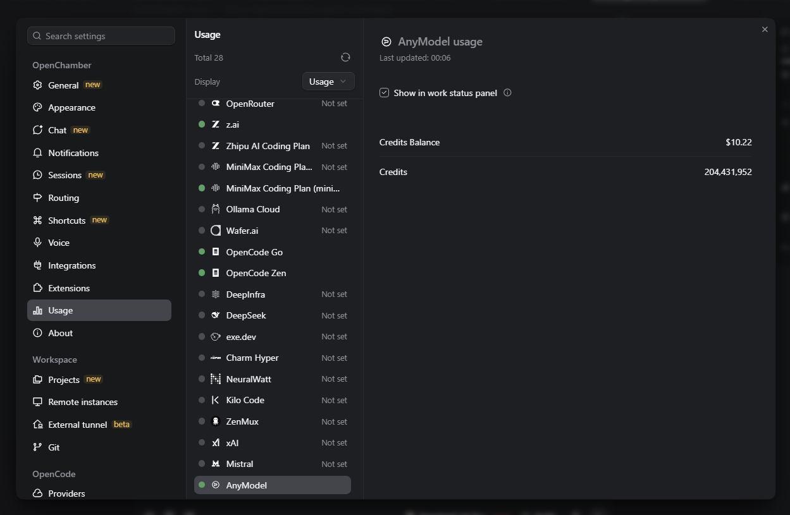
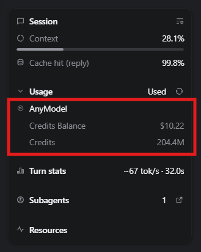

# AnyModel Usage

OpenChamber extension that adds AnyModel's prepaid balance to the Usage page,
the header, Work Status and the desktop tray — as a usage provider (`quota`
service role) next to the built-in providers.

AnyModel is pay-as-you-go with no subscription, so there are no quota windows
with percents or resets: the card shows two rows, **Credits Balance** in
dollars and **Credits** as the raw balance-token count (1,000,000 balance
tokens = $0.05). An `unlimited` key shows a single `Unlimited` row.

Requires OpenChamber 2.6.0 or newer. Built with `@openchamber/sdk` 2.8.x.

## Screenshots





## Install

### From GitHub (auto-updates)

In OpenChamber: **Settings → Extensions → Add extension → URL** and paste:

```
https://github.com/amaranth1618/anymodel-usage
```

The Extensions page checks the repository's `package.json` version and offers
**Update** when a new release lands.

### From a folder (development)

1. In OpenChamber: **Settings → Extensions → Add extension → Folder** and
   pick this directory.
2. Approve the local service. The approval dialog names `anymodel` as the
   provider whose credential the extension receives — that one key only.
3. Make sure OpenCode holds an `anymodel` credential in its **credential
   store**: the usage provider reads the credential OpenCode stores, not the
   `settings.apiKey` an OpenCode config file may carry. In OpenChamber:
   **Settings → Providers → AnyModel** and store the API key there, or run
   `opencode auth login`, choose **Other**, type `anymodel` and paste the key.
4. Open **Settings → Usage**: the **AnyModel** card sits after the
   built-ins. Tick **Show in work status panel** to see it in Work Status,
   the header and the tray.

## How it works

OpenChamber posts one `usage.read` call to the service at `POST /quota` per
refresh, carrying the credential OpenCode holds for `anymodel` and nothing
else. The service reads `GET https://anymodel.org/v1/balance` with that key
as a bearer, over a fixed origin with redirects refused, and answers the
windows a built-in provider computes. OpenChamber derives the remaining
share, reset countdown and formatting, so the card matches the built-ins
field for field.

The service runs on demand and stops after ten minutes without a call. It
never logs the key and never returns it in an answer.

## Development

```sh
npm install
npm run typecheck
npm test          # bun test tests
npm run build     # bundles service/main.ts into the checked-in service/main.js
```

OpenChamber never builds an extension on install, so the bundled
`service/main.js` is committed. To ship an update, bump `version` in
`package.json`, rebuild, commit and push; the Extensions page then offers
**Update** for Git-URL installs.

The window named `credits` renders under the localized "Credits" title, the
closest title the host UI provides for a numeric balance window; there is no
"Tokens" window title in the host UI today.
