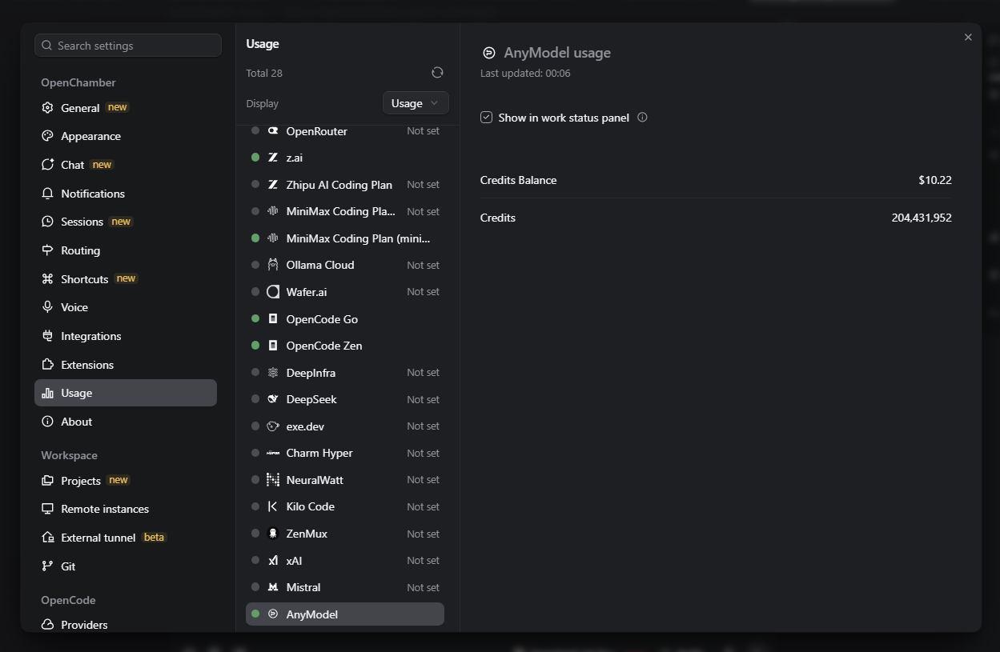
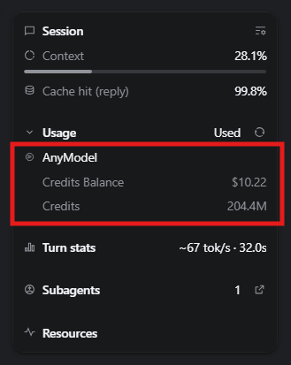

# AnyModel Usage

[English](README.md) | Русский

Расширение OpenChamber, которое добавляет предоплаченный баланс AnyModel на
страницу Usage, в шапку, Work Status и трей рабочего стола — как
usage-провайдера (сервисная роль `quota`) рядом со встроенными провайдерами.

У AnyModel оплата по факту, без подписки, поэтому окон квот с процентами и
сбросами нет: карточка показывает две строки — **Credits Balance** в долларах
и **Credits** — количество балансовых токенов (1 000 000 балансовых токенов =
$0.05). Для безлимитного ключа показывается одна строка `Unlimited`.

Требуется OpenChamber 2.6.0 или новее. Собрано на `@openchamber/sdk` 2.8.x.

## Скриншоты





## Установка

### Из GitHub (с автообновлением)

В OpenChamber: **Settings → Extensions → Add extension → URL**, вставьте:

```
https://github.com/amaranth1618/anymodel-usage
```

Страница расширений сверяет версию в `package.json` репозитория и предлагает
кнопку **Update**, когда выходит новый релиз.

### Из папки (для разработки)

1. В OpenChamber: **Settings → Extensions → Add extension → Folder** и
   выберите эту папку.
2. Одобрите локальный сервис. В диалоге будет назван провайдер `anymodel` —
   расширение получает только этот ключ и ничего больше.
3. Убедитесь, что OpenCode хранит ключ `anymodel` в **credential store**:
   usage-провайдер читает ключ из хранилища OpenCode, а не `settings.apiKey`
   из конфигурационного файла OpenCode. В OpenChamber: **Settings → Providers
   → AnyModel**, сохраните там API-ключ; либо выполните `opencode auth login`,
   выберите **Other**, введите `anymodel` и вставьте ключ.
4. Откройте **Settings → Usage**: карточка **AnyModel** идёт после
   встроенных. Включите **Show in work status panel**, чтобы видеть её в
   Work Status, шапке и трее.

## Как это работает

OpenChamber при каждом обновлении отправляет сервису один вызов `usage.read`
на `POST /quota` — с тем ключом, который OpenCode хранит для `anymodel`, и
ничем больше. Сервис обращается к `GET https://anymodel.org/v1/balance`,
передавая ключ как bearer, по фиксированному адресу с запретом редиректов, и
отвечает окнами в том же виде, в котором их считает встроенный провайдер.
Оставшуюся долю, отсчёт до сброса и форматирование OpenChamber вычисляет сам,
поэтому карточка совпадает со встроенными «поле в поле».

Сервис запускается по требованию и останавливается через десять минут без
вызовов. Ключ нигде не логируется и никогда не возвращается в ответах.

## Разработка

```sh
npm install
npm run typecheck
npm test          # bun test tests
npm run build     # собирает service/main.ts в хранимый в репозитории service/main.js
```

OpenChamber никогда не собирает расширение при установке, поэтому собранный
`service/main.js` хранится в репозитории. Чтобы выпустить обновление: поднимите
`version` в `package.json`, пересоберите, закоммитьте и запушьте — на странице
расширений появится **Update** для установок по Git URL.

Окно с именем `credits` выводится под локализованным заголовком «Credits» —
это ближайший заголовок, который интерфейс хоста даёт числовому окну баланса;
заголовка «Tokens» в интерфейсе хоста сейчас нет.
